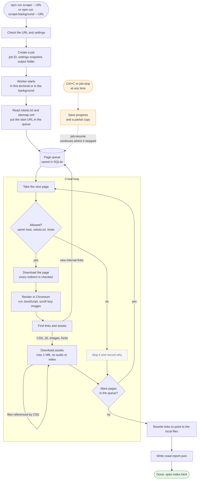
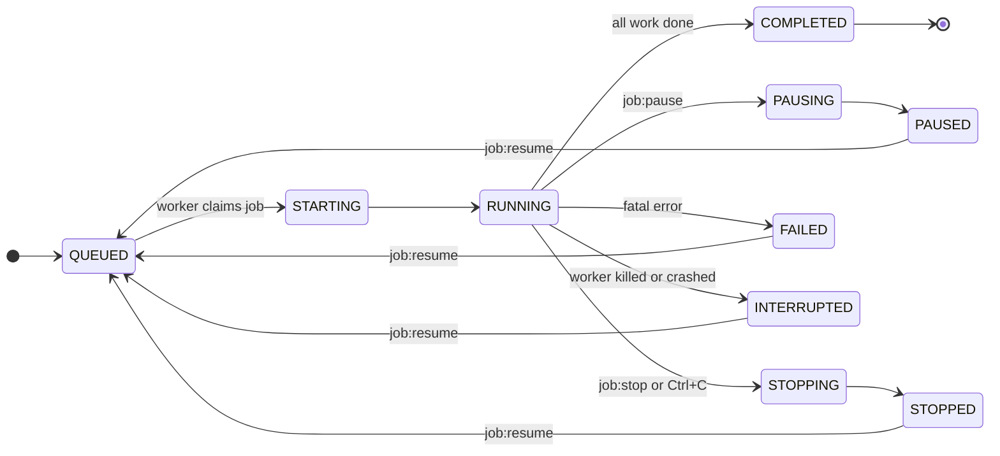

# Website Scraper

A configurable Node.js website crawler and downloader that captures publicly accessible websites for offline browsing, design reference and frontend development. It supports static and JavaScript-rendered pages, recursive crawling, asset downloading, strict domain filtering, file-size limits and resumable background scraping jobs.

Maintained by **Inertia Pixel**.

Topics: `nodejs` `website-scraper` `web-crawler` `playwright` `cheerio` `website-downloader` `web-archiver` `offline-browsing` `web-scraping`

> **What this is not:** a site cloner. Downloading public pages and assets cannot reproduce backend code, databases, APIs, logins, forms, checkout flows or all interactive behaviour. The result is a visual, browsable reference copy.

---

## Contents

- [Features](#features)
- [How it works](#how-it-works)
- [Requirements](#requirements)
- [Installation](#installation)
- [Quick start](#quick-start)
- [CLI commands](#cli-commands)
- [Domain scope](#domain-scope)
- [Configuration reference](#configuration-reference)
- [Output layout](#output-layout)
- [Job lifecycle](#job-lifecycle)
- [Background workers](#background-workers)
- [Resume and recovery guarantees](#resume-and-recovery-guarantees)
- [Running under PM2 or systemd](#running-under-pm2-or-systemd)
- [Architecture](#architecture)
- [Testing](#testing)
- [Troubleshooting](#troubleshooting)
- [Responsible use: robots.txt and rate limits](#responsible-use-robotstxt-and-rate-limits)
- [Legal, copyright and licensing](#legal-copyright-and-licensing)
- [Known limitations](#known-limitations)
- [Contributing](#contributing)
- [License](#license)

---

## Features

- **Static and JavaScript-rendered sites.** Pages are rendered in headless Chromium (Playwright), so links and content created by React, Next.js, Vue and similar frameworks are discovered. A plain-HTTP renderer is available for static sites.
- **Recursive crawling.** Breadth-first, unlimited depth by default, with sitemap discovery (including sitemap indexes and gzip sitemaps) and robots.txt `Sitemap:` declarations.
- **Strict domain scope.** Only the exact starting hostname is crawled by default. `www.example.com` is treated as a separate host. Hostnames are compared exactly after URL parsing, never by substring.
- **Asset capture.** Stylesheets (with recursive `@import`), fonts, images (`src`, `srcset`, `<picture>`, posters, CSS backgrounds, `image-set()`), scripts, icons, SVG sprites, inline `style` attributes and `<style>` blocks, plus common lazy-loading attributes (`data-src`, `data-srcset`, ...).
- **File filtering.** Per-file size limit (default **1 MB**), enforced while streaming, even without `Content-Length`. Audio and video are excluded by extension, by MIME type (`video/*`, `audio/*`) and by file signature.
- **Offline rewriting.** References to captured pages and assets become relative local paths. Anything skipped or failed stays as an absolute URL.
- **Job-based execution.** Every crawl is a durable job in SQLite with a unique ID, a configuration snapshot, counters, a persisted queue, per-job logs and a crawl report.
- **Background workers.** Detached worker processes with lease-based ownership, heartbeats, graceful stop/pause, safe resume and stale-worker detection.
- **Safety.** SSRF protection for both the HTTP client and the browser, path-traversal-proof output paths, bounded concurrency, per-host rate limits, timeouts, retries with exponential backoff, and secret redaction in logs.

## How it works



## Requirements

- **Node.js 22.12 or newer.** Node 24 LTS is recommended (`.nvmrc` is provided).
- **Chromium for Playwright**, installed with one command (see below). Only required for the default `browser` renderer.
- macOS, Linux or Windows. Development and the full test suite were run on macOS. The Linux code paths are the same; Windows-specific process inspection (PowerShell) exists but has not been tested.
- `better-sqlite3` ships prebuilt binaries for current Node LTS releases. On unusual platforms it may need a C/C++ toolchain to build.

## Installation

```bash
git clone git@github.com:inertiapixel/website-scraper.git
cd website-scraper
npm install
```

### Browser installation

The default renderer uses Playwright's Chromium build. Install it once per machine (it is cached outside the project):

```bash
npm run browsers:install
# equivalent to: npx playwright install chromium
```

On Linux servers you may also need the system libraries Chromium depends on:

```bash
npx playwright install --with-deps chromium
```

If you only capture static sites, you can skip the browser and use `--renderer http`.

## Quick start

```bash
# Crawl in the foreground (Ctrl+C stops gracefully; the job can be resumed)
npm run scrape -- https://example.com

# Start a background job and return immediately
npm run scrape:background -- https://example.com

# Follow it
npm run jobs
npm run job:status -- <JOB_ID>
npm run job:logs -- <JOB_ID> --follow
```

When the job finishes, open the `index.html` printed under **Open:** in a browser.

Starting a background job prints the real job ID and output path:

```text
Website Scraper

Background job created successfully.

Job ID: job_20261106_093012_3f9a1c2e
Website: https://example.com/
Status: RUNNING
Mode: BACKGROUND
Worker PID: 48121
Output: scraped-websites/example.com/job_20261106_093012_3f9a1c2e/

Check status:
npm run job:status -- job_20261106_093012_3f9a1c2e

View logs:
npm run job:logs -- job_20261106_093012_3f9a1c2e
```

> When using npm scripts, put options after `--` so npm passes them through:
> `npm run scrape -- https://example.com --max-pages 50`.
> You can also call the CLI directly: `node bin/website-scraper.js scrape https://example.com --max-pages 50`.

## CLI commands

| npm script | Direct command | Purpose |
| --- | --- | --- |
| `npm run scrape -- <url> [options]` | `scrape <url>` | Crawl in the foreground |
| `npm run scrape:background -- <url> [options]` | `scrape <url> --background` | Create a job and run it in a detached worker |
| `npm run jobs` | `jobs [--status S] [--limit N] [--json]` | List jobs (newest first) |
| `npm run job:status -- <JOB_ID>` | `status <id> [--watch] [--json]` | Progress, counters, activity, worker health, last error |
| `npm run job:logs -- <JOB_ID>` | `logs <id> [--follow] [--lines N] [--all]` | Timestamped job log |
| `npm run job:stop -- <JOB_ID>` | `stop <id> [--timeout S] [--no-wait] [--force]` | Graceful stop (writes the partial output and report) |
| `npm run job:pause -- <JOB_ID>` | `pause <id>` | Pause a running job |
| `npm run job:resume -- <JOB_ID>` | `resume <id> [--foreground] [--retry-failed]` | Continue a paused, stopped, interrupted or failed job |
| `npm run config:check` | `config [options]` | Validate and print the effective configuration |
| `npm run help` | `help [command]` | Help (for example `npm run help -- scrape`) |

### Scrape options

Options override `scraper.config.json` for one job only.

| Option | Config key |
| --- | --- |
| `-b, --background` | run in a detached worker |
| `-c, --config <file>` | merge a JSON overlay file (repeatable) |
| `--max-depth <n\|unlimited>` | `crawler.maxDepth` |
| `--max-pages <n\|unlimited>` | `crawler.maxPages` |
| `--concurrency <n>` | `crawler.concurrency` |
| `--delay <ms>` | `crawler.requestDelayMs` |
| `--timeout <ms>` | `crawler.navigationTimeoutMs` |
| `--renderer <browser\|http>` | `crawler.renderer` |
| `--user-agent <string>` | `crawler.userAgent` |
| `--include-subdomains` | `website.includeSubdomains` |
| `--allow-host <host>` (repeatable) | `website.allowedHosts` |
| `--exclude-host <host>` (repeatable) | `website.excludedHosts` |
| `--include-path <pattern>` (repeatable) | `crawler.includePaths` |
| `--exclude-path <pattern>` (repeatable) | `crawler.excludePaths` |
| `--crawl-external-pages` | `website.crawlExternalPages` |
| `--external-assets` / `--no-external-assets` | `website.downloadExternalAssets` |
| `--no-assets` | `download.enabled = false` |
| `--max-file-size <MB\|unlimited>` | `download.maxFileSizeMb` |
| `--no-sitemap` | `crawler.sitemap.enabled = false` |
| `--ignore-robots` | `crawler.respectRobotsTxt = false` (prints a warning) |
| `-o, --output <dir>` | `output.baseDir` |
| `--remove-scripts` | `output.removeScripts` |
| `--no-rewrite` | `output.rewriteUrls = false` |
| `--allow-private-network` | `network.allowPrivateNetworks` (trusted local testing only) |
| `--set <key.path=value>` | any key, for example `--set crawler.settle.delayMs=2000` (value parsed as JSON when possible) |

Invalid values, unknown options and misspelled keys produce a clear error and a non-zero exit code.

## Domain scope

By default only the **exact hostname** of the starting URL is crawled. For `https://xyz.com`:

| URL | Default behaviour |
| --- | --- |
| `https://xyz.com/`, `/about`, `/services` | crawled |
| `https://www.xyz.com/` | ignored (`www` is a subdomain) |
| `https://crm.xyz.com/`, `admin.`, `blog.` | ignored |
| `https://notxyz.com/`, `https://xyz.com.evil.net/` | ignored (look-alike domains never match) |
| `https://otherdomain.com/` | ignored |

- Add hosts explicitly: `--allow-host www.xyz.com` (or `"allowedHosts": ["www.xyz.com", "*.partner.com"]`).
- `--include-subdomains` allows the root host and every true subdomain (`*.xyz.com`), but never look-alikes such as `notxyz.com`.
- `excludedHosts` always wins.
- Redirects are re-validated at every hop, so a redirect can never pull the crawler onto another host. A start URL that redirects elsewhere (commonly `xyz.com` → `www.xyz.com`) makes the job fail with a message telling you which host to allow.
- **Pages and assets are separate permissions.** With `downloadExternalAssets` (default `true`), CDN files such as fonts and images are downloaded, but pages on those hosts are never crawled. Restrict asset hosts with `externalAssetHosts`.
- `crawlExternalPages: true` captures external pages linked from the site, but links on those pages are not followed.
- Only `http:` and `https:` URLs are fetched. URLs containing credentials are rejected.

## Configuration reference

`scraper.config.json` in the project root is the **single source of defaults**. It must contain every key, and unknown or misspelled keys are errors (with "did you mean" suggestions). You can:

- edit `scraper.config.json` to change defaults,
- pass partial overlay files with `--config my-site.json` (deep-merged; arrays replace), and
- override individual values on the command line.

For sites with tens of thousands of pages, start from [`examples/large-site.json`](examples/large-site.json) (`--config examples/large-site.json`): it raises the crawl-trap limits that would otherwise cut a large site short.

Run `npm run config:check` to validate and print the effective configuration. When a job is created, the effective configuration is **snapshotted into the job**. Later edits never change an existing job, including on resume.

**Path patterns** (`includePaths`, `excludePaths`, `excludedUrlPatterns`):

- `"/blog"` matches `/blog` and everything below it (segment boundary, so not `/blogger`).
- `*` matches within one path segment; `**` matches anything.
- `"re:<regex>"` is a JavaScript regular expression.

**Host patterns** are exact hostnames or `*.example.com` (subdomains only).

### `website`

| Key | Default | Description |
| --- | --- | --- |
| `startUrl` | `null` | Starting URL. Normally given on the command line. |
| `allowedHosts` | `[]` | Extra hosts whose pages may be crawled. |
| `excludedHosts` | `[]` | Hosts that are never contacted (pages or assets). |
| `includeSubdomains` | `false` | Crawl the start host and its true subdomains. |
| `crawlExternalPages` | `false` | Capture linked external pages without following their links. |
| `downloadExternalAssets` | `true` | Download assets (CSS, fonts, images, scripts) hosted on other hosts, such as CDNs. |
| `externalAssetHosts` | `[]` | If non-empty, only these external hosts may serve assets. |

### `crawler`

| Key | Default | Description |
| --- | --- | --- |
| `renderer` | `"browser"` | `browser` (Chromium, runs JavaScript) or `http` (raw HTML, no JavaScript). |
| `maxDepth` | `null` | Maximum link depth (start page = 0). `null` = unlimited. Sitemap URLs count as depth 1. |
| `maxPages` | `null` | Maximum number of pages accepted into the crawl. `null` = unlimited. |
| `concurrency` | `2` | Pages processed in parallel (1–16). |
| `requestDelayMs` | `500` | Minimum interval between page requests to the same host. |
| `navigationTimeoutMs` | `30000` | Timeout for fetching and navigating one page. |
| `maxPageSizeMb` | `10` | Pages larger than this are skipped. |
| `userAgent` | `WebsiteScraper/1.0 (+https://github.com/inertiapixel/website-scraper)` | Sent by both the HTTP client and the browser. The first token is used for robots.txt matching. |
| `respectRobotsTxt` | `true` | Apply robots.txt rules and `Crawl-delay` to page URLs. |
| `maxRobotsCrawlDelayMs` | `30000` | Upper bound for a robots.txt `Crawl-delay`. |
| `retries` | `2` | Retries for retryable page failures (network errors, timeouts, 408/425/429/5xx). |
| `retryBackoffMs` | `1000` | Base for exponential backoff with jitter. `Retry-After` is honoured. |
| `maxRedirects` | `10` | Redirect hops per request. |
| `includePaths` | `[]` | If non-empty, only matching paths are crawled (the start page is exempt). |
| `excludePaths` | `[]` | Matching paths are skipped. |
| `ignoreTrailingSlash` | `true` | Treat `/about` and `/about/` as the same page. |
| `settle.waitUntil` | `"load"` | Navigation event to wait for: `commit`, `domcontentloaded` or `load`. |
| `settle.networkQuietMs` | `500` | How long the network must be idle to count as settled. |
| `settle.networkQuietTimeoutMs` | `5000` | Maximum wait for that quiet period. Long-polling and analytics only cost this much; `networkidle` is never required. |
| `settle.delayMs` | `500` | Fixed extra wait before the DOM is captured. |
| `settle.waitForSelector` | `null` | Optional CSS selector to wait for (browser renderer only). |
| `lazyLoad.enabled` | `true` | Scroll through the page to trigger lazy loading. |
| `lazyLoad.maxScrolls` | `30` | Upper bound on scroll steps (protects against infinite scroll). |
| `lazyLoad.scrollDelayMs` | `200` | Pause after each scroll step. |
| `lazyLoad.promoteDataAttributes` | `true` | In saved pages, move `data-src`/`data-srcset` into `src`/`srcset` when `src` is a placeholder. |
| `sitemap.enabled` | `true` | Read `/sitemap.xml` and robots.txt `Sitemap:` entries as crawl seeds. |
| `sitemap.maxUrls` | `10000` | Maximum URLs taken from sitemaps. |
| `sitemap.maxSitemaps` | `50` | Maximum sitemap files (including nested indexes). |
| `queryParams.mode` | `"keep"` | `keep` (minus `strip`), `allowlist` (only `allow`) or `drop` (remove all query strings). |
| `queryParams.allow` | `[]` | Parameters kept in `allowlist` mode (`*` wildcards allowed). |
| `queryParams.strip` | `utm_*`, `fbclid`, `gclid`, ... | Tracking parameters removed before deduplication. |
| `queryParams.sort` | `true` | Sort parameters, so `?a=1&b=2` equals `?b=2&a=1`. |
| `trapProtection.maxUrlLength` | `2048` | Longer URLs are skipped. |
| `trapProtection.maxPathSegments` | `20` | Deeper paths are skipped. |
| `trapProtection.maxRepeatedSegments` | `3` | A path segment repeating more often is a loop (`/a/b/a/b/...`). |
| `trapProtection.maxQueryVariantsPerPath` | `50` | Query-string variants allowed per path (pagination and filter explosions). `null` = unlimited. |
| `trapProtection.maxUrlsPerPattern` | `1000` | URLs allowed per numeric pattern (`/calendar/{n}/{n}`). `null` = unlimited. Raise it for large catalogues with numeric IDs. |
| `trapProtection.maxDiscoveredUrls` | `100000` | Hard cap on recorded page and asset URLs per job. Further URLs are counted, not stored. |
| `blockBrowserResourceTypes` | `["media"]` | Browser request types never loaded while rendering (Playwright resource types). Add `"image"` or `"font"` to reduce traffic. Assets are still downloaded by the HTTP downloader. |

### `download`

| Key | Default | Description |
| --- | --- | --- |
| `enabled` | `true` | Download page assets. |
| `maxFileSizeMb` | `1` | Per-file limit in MB, enforced on the actual bytes while streaming. `null` = unlimited. |
| `concurrency` | `4` | Parallel asset downloads. |
| `requestDelayMs` | `100` | Minimum interval between asset requests to the same host. |
| `timeoutMs` | `30000` | Total time allowed per download (connect, redirects and body). |
| `retries` | `2` | Retries for retryable download failures. |
| `retryBackoffMs` | `1000` | Base for exponential backoff. |
| `existingFiles` | `"skip"` | On resume: `skip` keeps files already downloaded (files that went missing are fetched again); `overwrite` downloads every asset again. |
| `maxCssImportDepth` | `5` | Maximum nesting of CSS `@import` and `url()` chains. |
| `includedCategories` | all except `video`, `audio` | Allowed categories: `stylesheet`, `script`, `image`, `font`, `document`, `data`, `video`, `audio`, `other`. |
| `excludedExtensions` | video and audio extensions | `.mp4 .m4v .mov .avi .mkv .webm .mpeg .mpg .ogv .wmv .flv .3gp .mp3 .wav .ogg .oga .m4a .aac .flac .wma .opus .weba .aiff` |
| `excludedMimeTypes` | `["video/*", "audio/*"]` | Exact types or `type/*` wildcards. |
| `excludedUrlPatterns` | `[]` | URL patterns that are never downloaded. |

How a file is checked:

1. **Before the request:** host scope, URL patterns, extension, and the category implied by the referencing element (`<video>`, `<audio>`, ...).
2. **After the response headers:** MIME type exclusions and categories. A `Content-Length` above the limit stops the download immediately.
3. **While streaming:** the decoded byte count is enforced (this also covers missing or wrong `Content-Length`, chunked responses and compressed "bombs"). The first bytes are sniffed, so audio or video with no extension, a misleading extension or a generic MIME type is still excluded.

Files are streamed to a temporary file and only moved into place when complete. A partial download is always deleted. Every skip is recorded with its reason.

### `output`

| Key | Default | Description |
| --- | --- | --- |
| `baseDir` | `"scraped-websites"` | Output root, relative to the current directory. |
| `preserveStructure` | `true` | Mirror URL paths. `false` uses a flat, hashed layout grouped by category. |
| `rewriteUrls` | `true` | Rewrite captured references to local relative paths. |
| `saveRenderedHtml` | `true` | Save the rendered DOM (after JavaScript). `false` saves the original server HTML; links are still discovered from the rendered DOM. |
| `removeScripts` | `false` | Remove `<script>` tags from saved pages (JSON data scripts are kept). Useful for stable snapshots of client-rendered apps. |
| `generateReport` | `true` | Write `crawl-report.json`. |
| `keepStaging` | `false` | Keep the raw staged HTML/CSS after a successful job (debugging). |

Each job always gets its own directory. This is not configurable, so jobs can never overwrite each other.

### `network` and `logging`

| Key | Default | Description |
| --- | --- | --- |
| `network.allowPrivateNetworks` | `false` | Allow loopback, private, link-local, CGNAT and cloud-metadata addresses. **Only for trusted local testing.** |
| `logging.level` | `"info"` | `debug`, `info`, `warn` or `error`. |

### Environment variables

| Variable | Purpose |
| --- | --- |
| `WEBSITE_SCRAPER_HOME` | State directory (job database, logs, staging). Default: `./.website-scraper`. |

## Output layout

```text
scraped-websites/
  example.com/
    job_20261106_093012_3f9a1c2e/
      index.html                      # https://example.com/
      about/index.html                # https://example.com/about
      blog/post.html                  # https://example.com/blog/post.html
      products/index.q-page-2-1a2b3c4d.html   # https://example.com/products?page=2
      _sites/www.example.com/...      # pages from other allowed hosts
      _assets/
        example.com/css/site.css      # asset URL paths preserved per host
        example.com/img/logo.png
        fonts.gstatic.com/s/...       # external CDN assets (pages never crawled)
      crawl-report.json
```

- `/` maps to `index.html`, `/about` to `about/index.html`, and paths ending in `.html`/`.htm` keep their name.
- Query variants get a readable slug plus a deterministic hash, so they never overwrite each other.
- A host on a non-default port gets a directory like `example.com_8080`.
- Every segment is sanitised for Windows/macOS/Linux (reserved names, illegal characters, length). Decoded `..` and `%2e%2e` tricks are neutralised, and every final path is checked to stay inside the job directory. Case-insensitive collisions (`Logo.png` vs `logo.png`) and file-vs-directory conflicts get distinct names.
- Assets without an extension, or with a misleading one, get an extension from their MIME type (`/style.php` served as CSS becomes `style.php.css`).
- `crawl-report.json` lists every discovered page and asset with its status (`COMPLETED`/`DOWNLOADED`, `SKIPPED`, `FAILED`), reason code and message, HTTP status, size and local path. It also includes summary counters, the top skip/failure reasons and the effective configuration.

Job state lives in `.website-scraper/` (`jobs.db`, `jobs/<id>/worker.log`, `jobs/<id>/staging/`). Both directories are ignored by git.

## Job lifecycle



| Status | Meaning |
| --- | --- |
| `QUEUED` | Created (or resumed) and waiting for its worker. |
| `STARTING` | A worker claimed the job lease. |
| `RUNNING` | Crawling. |
| `PAUSING` / `STOPPING` | A pause/stop was requested; in-flight work is finishing. |
| `PAUSED` / `STOPPED` | Halted by the user; partial output and a partial report are written. Resumable. |
| `COMPLETED` | All work done **and** finalization (rewriting, report) succeeded. Terminal. |
| `FAILED` | An unrecoverable error, or no page could be captured. Resumable. |
| `INTERRUPTED` | The worker died or was terminated externally (crash, `kill`, reboot, SIGTERM from the OS). Resumable. |

Every transition is a compare-and-set update in SQLite, so the CLI and a worker can never apply conflicting changes. A job is never marked `COMPLETED` while pages or assets are still pending or if finalization fails.

## Background workers

- `scrape:background` creates the job, spawns a **detached Node.js process** (`bin/website-scraper-worker.js`), waits until the worker has claimed the job, and returns.
- The worker runs in its own session and keeps running after the terminal that started it closes. Its stdout/stderr go to the job log: `.website-scraper/jobs/<id>/worker.log`.
- **No duplicate workers.** A job can only be claimed with a single-use dispatch token and an atomic database lease. A second worker (or a second `resume`) for the same job is refused. The PID is written by the worker itself when it claims the lease, which avoids PID-file startup races.
- **Safe signalling.** Before `stop`/`pause` sends a signal, the PID is verified: the process must be alive, its start time must match the one the worker recorded, and (for background workers) its command line must be the worker for that job. A reused PID is never signalled. Stop and pause also work without signals: the worker polls the job status with its heartbeat.
- **Signals.** `SIGTERM`/`SIGINT` trigger a graceful stop: in-flight pages get up to 15 seconds, aborted items return to the queue, then partial output is written. A second signal exits immediately with progress saved. A `SIGTERM` that was not requested through the CLI (for example from the OS or a supervisor) marks the job `INTERRUPTED`. Uncaught exceptions and unhandled rejections mark the job `FAILED`.
- **Stale workers.** Workers heartbeat every 5 seconds. `jobs`, `status`, `stop`, `resume` and `logs --follow` detect workers that died (dead PID, PID reused, or an expired lease for workers on another host) and mark their jobs `INTERRUPTED`.
- **Reboots and logouts.** Detached workers are ordinary processes. They do **not** survive a reboot, and some systems also end them on logout (for example `systemd-logind` with `KillUserProcesses=yes`). After a reboot the job shows as `INTERRUPTED` and can be resumed. Use PM2 or systemd if you need supervision.

## Resume and recovery guarantees

These are persisted in SQLite (WAL mode). Every state change is committed as it happens:

- the page frontier (URL, depth, source, attempts, next retry time) and the set of every URL already seen, including redirect aliases,
- each asset's state, final URL, size, MIME type and local path,
- the reserved local paths, so files keep their names across runs,
- the configuration snapshot, the sitemap-seeding flag and the error/retry information.

On resume, items that were in progress return to the queue. Completed pages are **not** fetched again. Downloaded assets are kept if their file still exists (`existingFiles: "skip"`) and downloaded again otherwise. Pages are staged unmodified and rewritten in a final pass, so the offline copy is regenerated consistently after any number of resumes.

Limits of the guarantee:

- Work that was in flight when a worker was killed is redone. A page or file can therefore be requested twice across a crash.
- If the machine loses power, the last few hundred milliseconds of progress may be lost. That work is simply repeated.
- `resume --retry-failed` also re-queues items that previously failed.

## Running under PM2 or systemd

Supervisors work best with **foreground** mode, so the supervisor owns the process.

**PM2.** Disable auto-restart, because each restart of `scrape` would create a new job:

```bash
pm2 start bin/website-scraper.js --name scrape-example --no-autorestart -- scrape https://example.com
pm2 logs scrape-example
# after a crash or reboot:
pm2 start bin/website-scraper.js --name resume-example --no-autorestart -- resume <JOB_ID> --foreground
```

**systemd** (`/etc/systemd/system/website-scraper@.service`):

```ini
[Unit]
Description=Website Scraper job resume (%i)
After=network-online.target

[Service]
Type=simple
WorkingDirectory=/opt/website-scraper
Environment=WEBSITE_SCRAPER_HOME=/var/lib/website-scraper
ExecStart=/usr/bin/node bin/website-scraper.js resume %i --foreground
KillSignal=SIGTERM
TimeoutStopSec=90
Restart=no
User=scraper

[Install]
WantedBy=multi-user.target
```

Create the job once (`npm run scrape:background -- https://example.com`, then stop it, or create it in the foreground). Then `systemctl start website-scraper@<JOB_ID>` resumes it under systemd. `TimeoutStopSec` gives the worker time to finish in-flight work. A `SIGTERM` from systemd marks the job `INTERRUPTED`, and it can be resumed again later.

## Architecture

```text
bin/website-scraper.js          CLI entry (npm scripts call this)
bin/website-scraper-worker.js   detached background worker entry
src/cli/                        argument parsing, commands, output formatting, help
src/config/                     schema (types/constraints) and loader (base + overlays + flags)
src/jobs/                       SQLite store, state machine, worker runtime, service ops, process identity
src/crawl/                      crawl orchestrator, asset filter, offline "materialize" pass
src/render/                     Playwright/Chromium renderer
src/net/                        HTTP client, SSRF guard proxy for the browser, IP policy, rate limiter
src/discovery/                  robots.txt (robots-parser) and sitemap discovery
src/content/                    HTML (cheerio) and CSS reference discovery/rewriting, file types, encodings
src/url/                        normalization, domain scope, path rules and trap heuristics
src/output/                     URL-to-path mapping, path safety, crawl report
```

Key design decisions:

- **SQLite (better-sqlite3)** is the job store. It gives real transactions, safe multi-process access in WAL mode, and synchronous writes that still work inside signal and exit handlers. Node's built-in `node:sqlite` is still experimental in current releases.
- **Fetch first, render second.** Each page is fetched by the HTTP client, which validates every redirect hop, enforces size limits and detects non-HTML responses. The validated document is then handed to Chromium with `route.fulfill`. The browser never navigates to an unvalidated URL, and the page is downloaded only once.
- **Guard proxy for the browser.** Playwright's request interception does not see redirect hops, so all Chromium traffic goes through an in-process forward proxy. It resolves every connection (including HTTPS tunnels, WebSockets and each redirect hop) through the same SSRF-checked DNS lookup and connects to exactly the checked address.
- **Two-phase output.** Pages and stylesheets are staged unmodified while crawling. A final pass rewrites references to files that were actually captured; everything else becomes an absolute URL. The pass is idempotent and runs again after resume. A stop or pause produces a usable partial copy.
- **CSSOM snapshot.** CSS-in-JS libraries often insert rules via `insertRule`, which never appear in the HTML. The renderer serializes those rules (and adopted stylesheets) into the saved page.
- **Dependencies:** `playwright`, `cheerio`, `robots-parser`, `better-sqlite3`. Everything else (HTTP, CLI parsing, tests) uses Node built-ins.

## Testing

```bash
npm test          # all unit and integration tests (node:test)
npm run test:unit # unit tests only
npm run check     # syntax check of every file, config validation, module loading
```

Tests never contact the internet. Integration tests start local fixture servers. Fake hostnames (`xyz.test`, `www.xyz.test`, `cdn.test`, `notxyz.test`, ...) are mapped to `127.0.0.1` inside the crawler, and the server routes by `Host` header. Covered areas include:

- exact-host matching, subdomain exclusion and inclusion, look-alike domains and out-of-scope redirects,
- normalization and deduplication, query variants, include/exclude rules and crawl traps,
- extension, MIME and signature filtering; declared, missing and incorrect `Content-Length`; streamed limits; gzip bombs; partial-file cleanup,
- safe path generation and traversal attempts, CSS and HTML extraction and rewriting,
- the job state machine, duplicate-worker prevention, graceful stop, resume from the persisted queue, stale-worker recovery after `kill -9`, configuration snapshots, and CLI status/log output,
- JavaScript-rendered pages (links added by scripts, IntersectionObserver lazy images, CSS-in-JS, never-ending long-poll requests) and SSRF attempts from inside the browser.

Browser tests are skipped with a message if Chromium has not been installed.

## Troubleshooting

| Symptom | Fix |
| --- | --- |
| `Chromium is not installed for Playwright` | `npm run browsers:install` (Linux servers: `npx playwright install --with-deps chromium`), or use `--renderer http`. |
| Job `FAILED`: "No pages were captured ... redirects to https://www.example.com/" | The site redirects to another host. Start from that host or add `--allow-host www.example.com`. |
| Everything is `SKIPPED` with `robots` | The site disallows crawling for this user agent. Respect it, or crawl only sites you are authorized to crawl. |
| `Refusing to connect to ... private, loopback, link-local or reserved address` | SSRF protection. For a trusted local test server, use `--allow-private-network`. |
| Pages look unstyled offline | Check `crawl-report.json` for skipped or failed stylesheets. Raise `--max-file-size` if CSS bundles exceed 1 MB. For client-rendered apps, try `--remove-scripts` so scripts cannot re-render the page offline. |
| Lazy images missing | Increase `crawler.lazyLoad.maxScrolls` / `scrollDelayMs` or `crawler.settle.delayMs`. |
| Crawl is slow | Defaults are deliberately polite. Raise `--concurrency`, lower `--delay` (only where permitted), or use `--renderer http` for static sites. |
| Job stuck in `RUNNING` after a reboot | Run `npm run jobs`; stale workers are detected and the job becomes `INTERRUPTED`. Then `npm run job:resume -- <JOB_ID>`. |
| `better-sqlite3` fails to install | Use a current Node LTS release, or install build tools (Xcode CLT, `build-essential`, or Visual Studio Build Tools). |
| `npm run scrape https://...` ignores options | Put options after `--`: `npm run scrape -- https://... --max-pages 10`. |

## Responsible use: robots.txt and rate limits

- robots.txt is honoured by default (parsed with the `robots-parser` package), including `Allow`/`Disallow` precedence, wildcards and `Crawl-delay` (capped by `maxRobotsCrawlDelayMs`). Per RFC 9309, a robots.txt that returns 4xx means no restrictions. One that cannot be fetched (5xx or network error, after retries) makes the host disallowed.
- robots.txt is applied to page URLs. Page requisites (CSS, images, fonts, scripts) are downloaded the way a browser would load them when viewing an allowed page.
- Defaults are conservative: 2 concurrent pages, 500 ms between page requests per host, 4 concurrent downloads with 100 ms per host, and `Retry-After` honoured on 429/503.
- The default user agent identifies the tool and links to this repository. Do not disguise the crawler to get around blocking.
- This tool does **not** and will not bypass logins, paywalls, CAPTCHAs, anti-bot systems or other access controls.

## Legal, copyright and licensing

- Website content, designs, images, fonts and code are usually protected by copyright and licence terms. Capturing a site for private reference does not give you the right to republish, redistribute or reuse it.
- Fonts and stock images are often licensed per domain or per use. Check the licence before using any downloaded asset in your own work.
- Respect each website's terms of service, robots.txt and rate limits, and applicable laws (for example copyright, database rights, computer-misuse and privacy laws). Do not capture personal data you are not entitled to process.
- You are responsible for how you use this tool and the material it downloads.

## Known limitations

- Output is a reference copy, not a functional clone: no backend, database, APIs, authentication, sessions, forms, search or checkout.
- Asset URLs built at runtime by JavaScript (dynamic `import()` chunks, `fetch()` calls, URLs in JS strings) are not rewritten. Scripts may fail or re-render differently when opened from disk. `--remove-scripts` gives a static snapshot of the rendered DOM.
- References inside JavaScript files, inside downloaded SVG files, and in `srcset`/CSS generated after capture are not rewritten.
- Service workers are blocked while rendering. Shadow DOM content, `<canvas>` drawings and media streams are not captured. The contents of cross-origin iframes are only captured if the iframe URL is itself in scope (as a separate page).
- Signed or expiring asset URLs may stop working, and content that depends on cookies, geolocation or A/B tests may differ from what you see in a browser.
- Authenticated or paywalled pages are out of scope by design.
- Browser rendering loads page resources through Chromium, and the downloader then fetches the assets it keeps, so some resources are transferred twice. Add `"image"`/`"font"` to `crawler.blockBrowserResourceTypes` to reduce this.
- `maxUrlsPerPattern` (default 1000) can cut off very large sites that use purely numeric URLs. Raise it or set it to `null` for such sites.

## Contributing

Contributions are welcome:

1. Fork the repository and create a feature branch.
2. Keep changes focused. Follow the existing style: ES modules, small modules, no unnecessary dependencies.
3. Add or update tests. Tests must use local fixtures only, never third-party websites.
4. Run `npm run check` and `npm test` before opening a pull request.
5. Describe the behaviour change and any configuration or documentation updates in the pull request.

Please report security issues privately to the maintainers rather than in a public issue.

## License

Website Scraper is **free** and open-source under the **MIT License**.  
See the full license [here](LICENSE).

The license covers this tool's source code only, not the content of websites you download with it (see [Legal, copyright and licensing](#legal-copyright-and-licensing)).

**Crafted in India by [InertiaPixel](https://www.inertiapixel.com/)**
